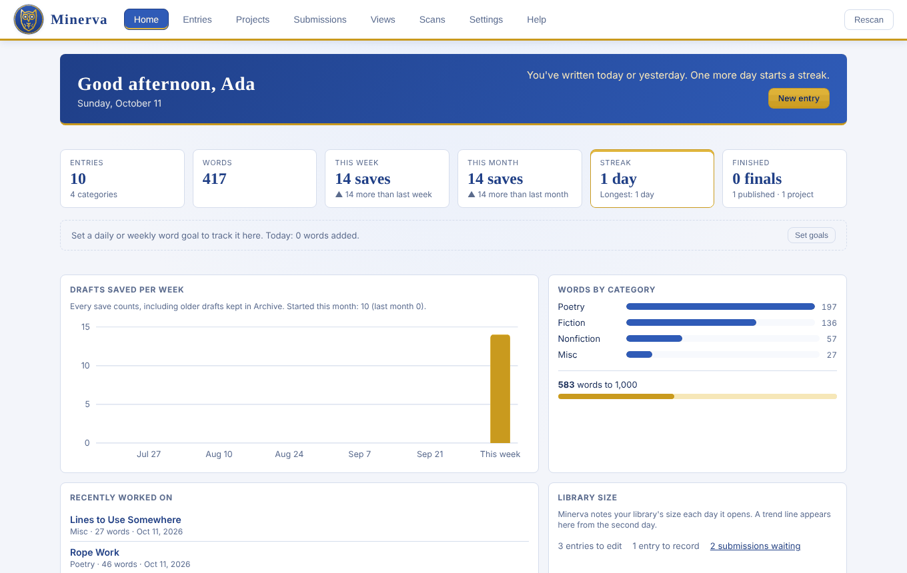
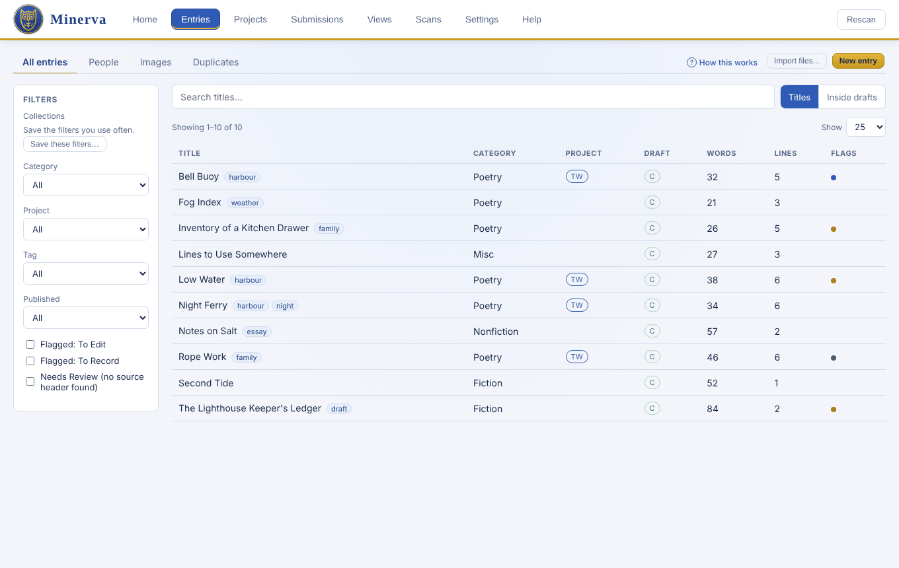
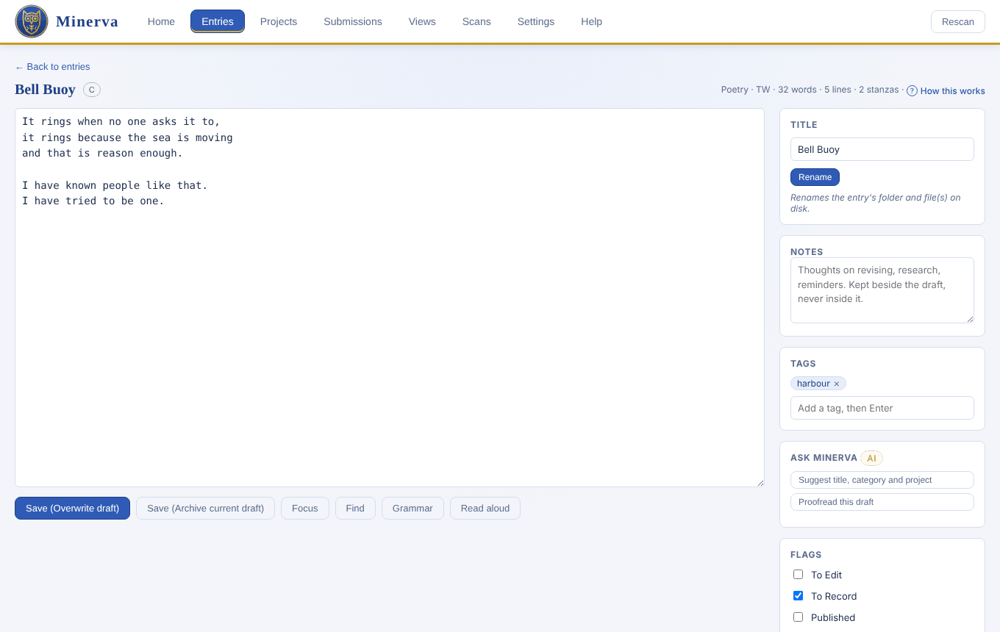
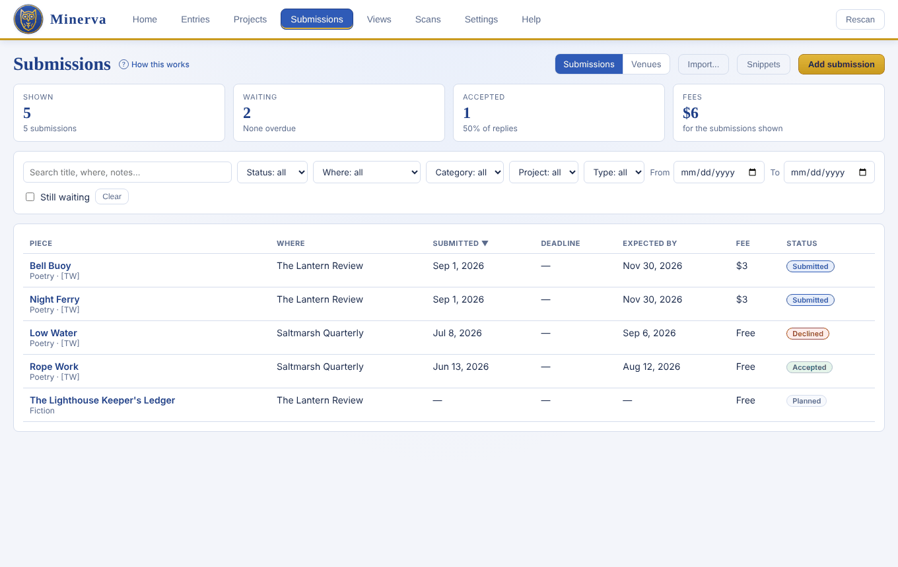

<p align="center"></p>

# Minerva

*A writer's best friend.* Minerva is a desktop app for keeping a lifetime of writing in order: every draft kept, pieces gathered into projects, submissions tracked, and old notebooks scanned and turned back into text.

Everything stays on your computer. Minerva works directly with ordinary folders and `.txt` files, so your writing is still readable without it. AI features are optional and use your own key or a free model running on your computer.

<p align="center"></p>

## What it does

- **Every draft kept.** Saving can archive the previous version first, and any two drafts can be compared side by side. Minerva never deletes your files.
- **Bring writing in.** Paste pieces in, import Word, Google Docs, Markdown, RTF, ODT, HTML and PDF files, pull in Evernote, Google Keep and Notion exports, or keep an Obsidian vault in sync.
- **Scans to text.** Transcribe photographed or scanned notebooks page by page, proofread each entry beside its page, and file it into your library.
- **Projects and tags.** Group pieces into collections, order them in an outline, and export a manuscript as Word, PDF or EPUB.
- **Submissions.** Track where each piece is out, deadlines and reading periods, fees and replies. Import from Submittable or The Grinder, or from confirmation emails.
- **Writing tools.** Find and replace across drafts, a focus mode, grammar and style checks with LanguageTool, word goals and streaks, read-aloud and narration.
- **Safe by design.** One-click backups, a library check on launch, an "export everything" bundle, and a sample library to try things in.

| | |
|---|---|
|  |  |
|  | |

## Download

Get the latest version from [Releases](../../releases). Minerva isn't code-signed yet, so your computer will ask you to confirm the first time you open it.

- **Windows 10 or 11:** download `Minerva.exe` and double-click it. If Windows says it protected your PC, click **More info**, then **Run anyway**. Minerva updates itself when a new version comes out.
- **macOS (Apple silicon):** download `Minerva-mac.zip`, unzip it and drag **Minerva** to Applications. The first time, open it, then go to **System Settings > Privacy & Security** and click **Open Anyway**.
- **Linux (x86-64):** download `Minerva-linux.tar.gz`, extract it and run `./Minerva`. It needs a desktop with the usual graphics libraries (any recent Ubuntu, Fedora or Mint has them).

If Minerva can't open its own window, it opens in your web browser instead.

## First run

1. **Choose your library.** Open a folder that already holds your writing, let Minerva create a new one, or explore the sample library first.
2. **AI (optional).** For reading handwritten scans and for suggestions, set up a free model on your computer (one click on Windows), or paste a key from Anthropic (Claude), OpenAI or Google Gemini. Keys are kept in your system's credential store (Windows Credential Manager, macOS Keychain or the Linux Secret Service), never in your library or in Minerva's settings file.

## How a library is laid out

```
Poetry\
  Morning Tide - [SEA]\            entry folder; "- [SEA]" is a project tag
    Morning Tide [C].txt           current draft ([J] = transcribed original)
    Archive\                       every older draft
    Images\                        pictures that belong to the entry
Sources\
  Blue Notebook\Scans\             scanned pages of a notebook
.minerva\                          Minerva's index (hidden)
```

## Running from source

Needs Python 3.10 or newer.

```
python -m pip install -r requirements-dev.txt
python run_minerva.py            # native window
python run_minerva.py --browser  # or in your browser
python -m pytest                 # tests
python packaging/build.py        # builds the app into dist/
```

On Windows, **Build Minerva.bat** does all of that: it installs what the build needs, runs the tests, builds `dist\Minerva.exe` and runs the app's self-test.

Tests use a small synthetic library. No real writing belongs in this repository.

## License

Minerva is released under the [MIT License](LICENSE).
